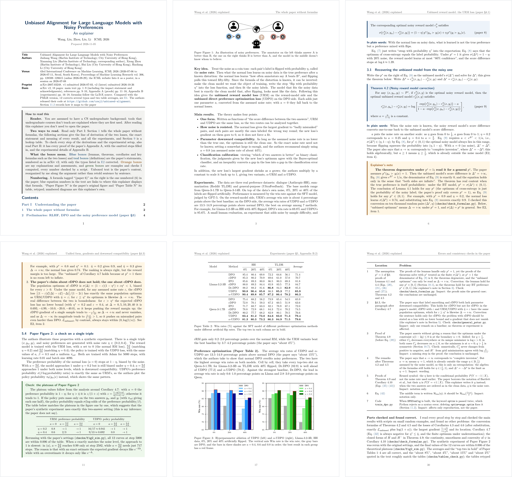

# paper-explainer

**English** | 简体中文

A Claude Code / Codex skill that turns an academic paper into a complete, concise explainer PDF, typeset with XeLaTeX, in Chinese or English. A reader with a CS undergraduate background can master every theorem, proof and experimental number in the paper without opening it. 



*Six of the 32 pages of an English explainer for an 18-page ICML 2026 paper, [Unbiased Alignment for Large Language Models with Noisy Preferences](https://arxiv.org/abs/2607.03248): the cover with the reading guide, the formula-free walkthrough, a theorem with its plain-words line and an explainer's note, a numerical check, a retyped table with the paper's own figure, and the errata.*

## What you get

- **Complete.** Whatever the paper has, the explainer has: every definition, assumption, theorem, lemma, proposition, corollary and claim, with its proof; every algorithm and numbered equation; every number in every table; every figure (the original, copied from the arXiv source or cropped from the PDF); all experimental settings and hyperparameters; and the role of every reference.
- **Concise.** Everything is said once. Undergraduate material such as calculus, linear algebra, probability and introductory machine learning is used without explanation; what a CS graduate wouldn't know (KL divergence, Rademacher complexity, policy gradients, …) is explained where it is first used. A 20-page paper typically becomes an explainer of about 30 pages.
- **Checked.** Every number in an example or a check comes from a script that was actually run, and the scripts are kept with the explainer. Retyped tables are compared number by number with the paper's source, and a coverage script lists anything numbered in the paper that the explainer never mentions. A suspected error in the paper is tested numerically, the original statement is rescued if the paper's own tools allow it, and an independent reviewer subagent judges each erratum before it is kept.
- **Resumable.** The inventory, outline and errata are written to files rather than kept only in the conversation, so a run that is interrupted or has its context compacted continues where it stopped.

### What an explainer contains

| Part | Contents |
|---|---|
| Part I: Understanding the paper | One or two pages telling the whole paper without formulas; then the exact statement, meaning and experiments of every result, in the order of the argument; an at-a-glance table at the end |
| Part II: Complete proofs | Every proof and long derivation, with the non-trivial steps the paper omits filled in; for experiment-driven papers, "Full details" instead, with every hyperparameter and experimental setting |
| Appendices E1–E3 | Differences between the latest arXiv version and the published one; errors found in the paper and how each was checked; every reference and its role in the paper |

Box colours show where the content comes from: blue and teal boxes hold the paper's statements, orange and green boxes the explainer's own notes and checks.

## Requirements

- Claude Code or OpenAI Codex
- TeX Live with `xelatex`. Chinese text uses the Fandol fonts bundled with TeX Live, so no fonts need installing.
- Python 3.10 or later, with PyMuPDF and Pillow:

  ```bash
  python -m pip install pymupdf pillow
  ```

- `curl`, `tar` and `git`, for downloading papers, sources and code. On Windows, Git for Windows provides all three.

Developed on Windows 11 with TeX Live 2026, Python 3.13, PyMuPDF 2.0 and Pillow 11.

## Installation

The easiest way is to ask your AI agent to install it for you, for example by telling Claude Code or Codex:

```text
Install the paper-explainer skill from https://github.com/cswjl/paper-explainer
```

To install it by hand, clone the repository into your personal skills folder, so that the skill is available in every project:

```bash
git clone https://github.com/cswjl/paper-explainer.git ~/.claude/skills/paper-explainer
```

In Windows PowerShell:

```powershell
git clone https://github.com/cswjl/paper-explainer.git "$env:USERPROFILE\.claude\skills\paper-explainer"
```

To use it in one project only, clone it into that project's `.claude/skills/paper-explainer` instead. Run `git pull` in the folder to update.

For Codex, clone it into `~/.agents/skills/paper-explainer`, the folder where Codex looks for personal skills (in PowerShell, `"$env:USERPROFILE\.agents\skills\paper-explainer"`):

```bash
git clone https://github.com/cswjl/paper-explainer.git ~/.agents/skills/paper-explainer
```

If a running session doesn't list the skill, start a new one.

## Usage

Ask in your own words, giving an arXiv link or ID, a title, or a local PDF:

```text
Explain this paper: https://arxiv.org/abs/2607.03248
Walk me through Unbiased Alignment for Large Language Models with Noisy Preferences
```

or call the skill directly: `/paper-explainer 2607.03248` in Claude Code, `$paper-explainer 2607.03248` in Codex.

The explainer is written in the language of your request: English for a request in English, Chinese for one in Chinese; an explicit "write it in English" wins. The skill is for understanding a paper thoroughly. For a question or two about a paper, a one-line summary, a peer review or group-meeting slides, just ask directly.

### Where the files go

All explainers are kept in one folder, so the skill can find unfinished runs and related papers. That folder is, in order of precedence:

1. a folder you name, in the request or in your `CLAUDE.md`;
2. the folder in the environment variable `PAPER_EXPLAINER_DIR`;
3. a folder on your desktop: `论文讲解` for Chinese explainers, `paper-explainers` for English ones. If only one of them exists, it is used for both.

Each paper gets a subfolder of its own:

```text
2026 - UDPO - Unbiased Alignment for Large Language Models with Noisy Preferences/
├── 2607.03248v2.pdf                          the paper, in the version explained
├── Wang2026_UnbiasedAlignment_explainer.pdf  the explainer
├── main.tex
├── sections/                                 LaTeX sources, one file per section
├── figures/                                  the paper's figures and the explainer's own
└── checks/                                   the scripts behind every computed number
```

Asking again about a paper that already has a folder continues an unfinished run; for a finished one, you are asked whether to update it or redo it.

## How it works

1. **Find the paper** and download two versions: the latest arXiv preprint, with its LaTeX source, and the formally published version. Code released by the authors is cloned to be read, never run.
2. **Read everything**, appendices included, and write an inventory of every numbered item, experimental setting and reference.
3. **Outline** the explainer, deciding where each thing is said so that nothing is said twice.
4. **Set up** the LaTeX skeleton from the bilingual template.
5. **Write** section by section; after each section, check it, compile it and lint it.
6. **Verify** numbers by script, tables against the source and derivations step by step, and record the errata.
7. **Compile and inspect**: no layout warnings left, every rendered page looked at, coverage checked against the paper.
8. **Review independently**: a fresh subagent judges the errata, spot-checks theorem boxes and flags repetition, without seeing how the errata were verified.
9. **Deliver**: tidy the folder and report the page count, the structure, the problems found and anything that couldn't be verified.

## Repository layout

```text
SKILL.md                    the workflow the agent follows
references/style-guide.md   writing and layout rules
assets/template/            bilingual XeLaTeX template (\zhtrue for Chinese, \zhfalse for English)
scripts/
├── build.py                compile in a separate folder; report overfull lines, undefined references, missing glyphs, …
├── check_tex.py            check the sources against the style guide
├── coverage.py             list the items of the paper that the explainer never mentions
├── figures.py              find the paper's figures in its source, or crop them from the PDF
├── bib_list.py             list the references with the sections that cite them
├── compare_numbers.py      compare the numbers in two text spans, e.g. a table and its retyped copy
└── render_pages.py         render PDF pages into contact sheets for visual review
docs/images/                the example pages shown above
```

The scripts also work on their own; each prints its usage with `--help`.

## Notes

- A full run is long: many tool calls, several compiles and a review subagent. Longer papers take more time and tokens.
- Downloads are treated as untrusted: each goes into its own folder, Python that reads them runs in isolated mode (`-I` or `-P`), EPS files are never converted, and the authors' code is never executed.
- In Claude Code / Codex, the independent review uses a Claude / Codex subagent; no other model or API key is needed.

## License

MIT
