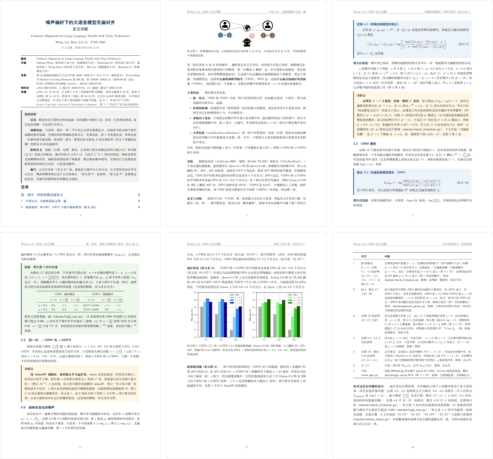

# paper-explainer

English | **简体中文**

一个 Claude Code / Codex skill：把一篇学术论文写成一份完整、简洁的讲解 PDF，用 XeLaTeX 排版，中文、英文都可以。有计算机本科基础的读者不用打开原文，就能掌握论文里的每个定理、每个证明和每个实验数字。



示例：18 页的 ICML 2026 论文 [Unbiased Alignment for Large Language Models with Noisy Preferences](https://arxiv.org/abs/2607.03248) 的中文讲解共 32 页，上图是其中 6 页：封面和阅读说明、不用公式讲完整篇论文、定理及其“用大白话说”和讲解注、验算、实验结果和原文的图、勘误表。

## 特点

- **完整**：原文有的，讲解里都有。每个定义、假设、定理、引理、命题、推论和断言，连同它的证明；每个算法和带编号的公式；每张表里的每个数字；每张图（用原图，从 arXiv 源文件复制，或者从 PDF 裁剪）；全部实验设置和超参数；每篇参考文献在文中的作用。
- **简洁**：每件事只说一次。微积分、线性代数、概率统计、机器学习入门这些本科知识直接用，不再讲解；本科课程不教的内容（KL 散度、Rademacher 复杂度、策略梯度……）在第一次用到时讲清楚。20 页左右的论文，讲解一般在 30 页左右。
- **经过核对**：例子和验算里的每个数字都来自实际运行过的脚本，脚本和讲解保存在一起。重排的表格逐个数字和原文源文件比对；覆盖检查脚本会列出原文里有编号、但讲解没有提到的条目。怀疑原文有错时，先用数值实验检验，能用原文自己的工具挽救原结论的就先挽救，每条勘误还要经过独立的 subagent 复核才保留。
- **可以续做**：清单、大纲和勘误都写进文件，不只留在对话里；任务中断或上下文被压缩之后，从停下的地方接着做。

### 讲解包含什么

| 部分 | 内容 |
|---|---|
| 第一部分：轻松读懂这篇论文 | 先用一两页、不用公式讲完整篇论文；再按论证顺序给出每个结果的准确陈述、含义和实验；最后是速查表 |
| 第二部分：完整证明 | 全部证明和长推导，补全原文省略的非平凡步骤；实验型论文换成“完整细节”，包括全部超参数和实验设置 |
| 附 1–3 | 最新 arXiv 版与正式发表版的差异；原文的错误，以及每条是怎么核对的；每篇参考文献及其在文中的作用 |

框的颜色表示内容的来源：蓝框、青框是原文的陈述，橙框、绿框是讲解自己补充的解释和验算。

## 环境要求

- Claude Code 或 OpenAI Codex
- TeX Live（需要 `xelatex`）。中文用 TeX Live 自带的 Fandol 字体，不用另装字体。
- Python 3.10 及以上，以及 PyMuPDF 和 Pillow：

  ```bash
  python -m pip install pymupdf pillow
  ```

- `curl`、`tar` 和 `git`，用来下载论文、源文件和代码。Windows 上装了 Git for Windows 就都有了。

开发环境：Windows 11、TeX Live 2026、Python 3.13、PyMuPDF 2.0、Pillow 11。

## 安装

最简单的办法是让 AI agent 直接帮你安装，比如对 Claude Code 或 Codex 说：

```text
帮我安装这个 skill：https://github.com/cswjl/paper-explainer
```

也可以手动安装：把仓库克隆到个人的 skills 目录，所有项目都能用。

```bash
git clone https://github.com/cswjl/paper-explainer.git ~/.claude/skills/paper-explainer
```

Windows PowerShell：

```powershell
git clone https://github.com/cswjl/paper-explainer.git "$env:USERPROFILE\.claude\skills\paper-explainer"
```

只想在某个项目里用，就克隆到那个项目的 `.claude/skills/paper-explainer`。以后在这个目录里运行 `git pull` 就能更新。

在 Codex 里用，就克隆到 Codex 查找个人 skill 的目录 `~/.agents/skills/paper-explainer`（PowerShell 里写成 `"$env:USERPROFILE\.agents\skills\paper-explainer"`）：

```bash
git clone https://github.com/cswjl/paper-explainer.git ~/.agents/skills/paper-explainer
```

如果正在运行的会话里看不到这个 skill，新开一个会话。

## 使用

用自己的话提出要求，给 arXiv 链接或编号、论文标题、本地 PDF 都可以：

```text
讲讲这篇论文：https://arxiv.org/abs/2607.03248
帮我读懂这篇论文：Unbiased Alignment for Large Language Models with Noisy Preferences
```

也可以直接调用：Claude Code 里用 `/paper-explainer 2607.03248`，Codex 里用 `$paper-explainer 2607.03248`。

讲解的语言跟你提要求时用的语言一致：用中文提就写中文讲解，用英文提就写英文讲解；明确说了“用英文写”之类的，以你说的为准。这个 skill 是用来彻底读懂一篇论文的；只想问一两个具体问题、要一句话总结、写审稿意见或者做组会 slides，直接提问就好。

### 文件放在哪里

所有讲解放在同一个目录里，这样 skill 能找到没做完的任务和相关的论文。这个目录按下面的顺序确定：

1. 你指定的目录，写在请求里或者 `CLAUDE.md` 里；
2. 环境变量 `PAPER_EXPLAINER_DIR` 指定的目录；
3. 桌面上的文件夹：中文讲解用 `论文讲解`，英文讲解用 `paper-explainers`。只有其中一个存在时，两种语言都放在那里。

每篇论文一个子文件夹：

```text
2026 - UDPO - Unbiased Alignment for Large Language Models with Noisy Preferences/
├── 2607.03248v2.pdf                     原论文（讲解依据的版本）
├── Wang2026_无偏对齐_讲解.pdf           讲解
├── main.tex
├── sections/                            LaTeX 源文件，每节一个文件
├── figures/                             原文的图和讲解自己画的图
└── checks/                              每个计算出来的数字背后的脚本
```

对已经有文件夹的论文再提一次要求：没做完的会接着做；已经做完的，会先问你是更新还是重做。

## 工作流程

1. **找论文**，下载两个版本：arXiv 最新版（连同 LaTeX 源文件）和正式发表版。作者公开的代码克隆下来只读，不运行。
2. **通读全文**，附录也不漏，把每个编号条目、实验设置和参考文献记进清单。
3. **设计大纲**，事先定好每件事在哪里说，避免重复。
4. **搭骨架**：用中英双语模板生成 LaTeX 框架。
5. **逐节写作**：每写完一节，就检查、编译、跑格式检查。
6. **核对**：数字用脚本算，表格和源文件比对，推导逐步检查，发现的问题记进勘误。
7. **编译并检查版面**：排版警告清零，逐页看渲染图，对照原文检查有没有遗漏。
8. **独立复核**：一个新的 subagent 判断每条勘误、抽查定理框、指出重复的段落；它看不到勘误是怎么核对的。
9. **交付**：整理文件夹，报告页数、结构、发现的问题，以及没能核实的地方。

## 仓库结构

```text
SKILL.md                    Agent 执行的工作流程
references/style-guide.md   写作和排版规范
assets/template/            中英双语 XeLaTeX 模板（\zhtrue 中文，\zhfalse 英文）
scripts/
├── build.py                在单独的目录里编译，报告溢出行、未定义的引用、缺失的字形等
├── check_tex.py            按写作规范检查源文件
├── coverage.py             列出原文里讲解没有提到的条目
├── figures.py              在源文件里找原文的图，或者从 PDF 裁剪
├── bib_list.py             列出参考文献，以及引用它们的章节
├── compare_numbers.py      按顺序比对两段文字里的数字，比如原表和重排后的表
└── render_pages.py         把 PDF 页面渲染成缩略图拼版，用来检查版面
docs/images/                上面的示例图
```

这些脚本也可以单独使用，加 `--help` 查看用法。

## 说明

- 完整跑一遍耗时较长：要调用很多次工具、编译多次，还有一个复核用的 subagent。论文越长，花的时间和 token 越多。
- 下载的文件一律当作不可信：每个下载放进单独的目录，读取它们的 Python 以隔离模式运行（`-I` 或 `-P`），不转换 EPS 文件，也不运行作者的代码。
- 在 Claude Code / Codex 里，独立复核用的是 Claude / Codex subagent，不需要其他模型或 API key。

## 许可证

MIT
